# NeuroMouse — академический отчёт по проекту

**Полное описание всех этапов, задач и полученных результатов**

| Параметр | Значение |
|---|---|
| Проект | NeuroMouse — исследовательский прототип обработки нейрофизиологических сигналов и ИИ-декодирования |
| Автор | Никита Кукса |
| Рабочая директория | `F:\NeuroMouse` |
| Окружение | `conda neuromouse` (Python 3.12) |
| Финальные данные отчёта | 26 октября 2026 |
| Завершённые этапы | 0, I, II, III, IV |
| Планируемые этапы | V, VI, VII, VIII |
| Версия кода | `73c4fa8` (ветка `master`) |

---

## Аннотация

Проект NeuroMouse развивается как последовательность из девяти этапов (0–VIII), ведущая от
учебного конвейера обработки ЭЭГ человека к двустороннему нейроинтерфейсу для мыши.
В отчёте приведено детальное описание **каждой задачи каждого этапа**: постановка, метод,
использованные библиотеки, формулы, входные и выходные артефакты, а также критическая
интерпретация ограничений.

К моменту составления отчёта полностью завершены пять этапов:

* **Этап 0** — фиксация исходного состояния проекта (окружение, исходная запись, первый скрипт, резервная копия).
* **Этап I** — воспроизводимый конвейер обработки ЭЭГ человека: полосовая фильтрация, признаки по частотным диапазонам, скрипт автоматической верификации (6 групп проверок, все пройдены).
* **Этап II** — подключение реальных нейрофизиологических данных мыши (Allen Brain Observatory, DANDI 000021; Steinmetz et al. 2019, DANDI 000017), внутренний реестр сессий.
* **Этап III** — первый ИИ-декодер: классификация положения зрительного стимула по спайковой активности 778 нейронов мыши (LDA: точность 65.31 % против 50 % случайного уровня).
* **Этап IV** — внеклеточная электрофизиология: spike sorting на синтетической записи с известным ground truth (точность восстановления 100 % по медиане), популяционный анализ 778 реальных юнитов (firing rate, ISI, PSTH, кросс-корреляции, сравнение условий стимула).

Ключевой вывод проекта на текущий момент: **вычислительный конвейер «сырой сигнал → сортировка → одиночные юниты → декодирование состояния» реализован и проверен на открытых данных**, а узким местом для перехода к собственной регистрации является аппаратная часть (этапы V–VII) и этико-правовая рамка (этап VII–VIII).

---

## Содержание

1. [Введение и постановка задачи](#1-введение-и-постановка-задачи)
2. [Данные проекта](#2-данные-проекта)
3. [Общая архитектура и технологический стек](#3-общая-архитектура-и-технологический-стек)
4. [Этап 0 — зафиксировать исходное состояние](#4-этап-0--зафиксировать-исходное-состояние)
5. [Этап I — конвейер обработки ЭЭГ](#5-этап-i--конвейер-обработки-ээг)
6. [Этап II — полноценный набор нейрофизиологических данных](#6-этап-ii--полноценный-набор-нейрофизиологических-данных)
7. [Этап III — первый ИИ-декодер](#7-этап-iii--первый-ии-декодер)
8. [Этап IV — от ЭЭГ к спайкам мыши](#8-этап-iv--от-ээг-к-спайкам-мыши)
9. [Этапы V–VIII — планируемая часть](#9-этапы-vviii--планируемая-часть)
10. [Инфраструктура проекта](#10-инфраструктура-проекта)
11. [Реестр рисков и открытых вопросов](#11-реестр-рисков-и-открытых-вопросов)
12. [Воспроизводимость](#12-воспроизводимость)
13. [Ограничения, научная и этическая рамка](#13-ограничения-научная-и-этическая-рамка)
14. [Приложения](#14-приложения)

---

## 1. Введение и постановка задачи

### 1.1 Цель проекта

NeuroMouse — это исследовательский прототип, в котором последовательно отрабатываются
все звенья нейроинтерфейса: от загрузки и очистки сигнала до машинного обучения и
замкнутого контура «регистрация → декодирование → ответное воздействие».

Конечная цель проекта (Этап VIII) — двусторонний нейроинтерфейс. Однако проект построен
по принципу **поэтапного наращивания сложности**: на каждом этапе появляется либо новый
источник данных, либо новая вычислительная способность, и этап закрывается только после
объективной проверки (воспроизводимость, верификационные скрипты, количественные метрики).

### 1.2 Научно-методическая рамка

Проект следует нескольким принципам, которые важно зафиксировать, поскольку они
определяют все инженерные решения:

| Принцип | Как реализован |
|---|---|
| Неизменность исходных данных | Исходная запись никогда не перезаписывается; фильтрация идёт по копии (`raw.copy()`) |
| Разделение данных и признаков | Отфильтрованные данные, признаки, модели и результаты лежат в разных директориях |
| Проверка меток до обучения с учителем | Метки событий для ЭЭГ и триалы для мыши верифицируются до подачи в модель |
| Воспроизводимость | Единая конфигурация в `src/config.py`, фиксированный `RANDOM_STATE = 42`, скрипты верификации |
| Прозрачность ограничений | Каждый этап фиксирует, чего он **не** доказывает (см. раздел 13) |

### 1.3 Что уже доказано, а что нет

Формулировка результата имеет значение. По итогам этапов 0–IV можно утверждать:

* **Доказано:** конвейер обработки сигналов воспроизводим бит-в-бит; алгоритм spike sorting
  корректно восстанавливает нейроны, когда истина известна; популяция из 778 нейронов мыши
  несёт статистически значимую информацию о положении зрительного стимула.
* **Не доказано:** обобщение на новые сессии без переобучения; корректность работы на
  собственной аппаратуре; безопасность обратного воздействия; причинно-следственная
  интерпретация корреляций между нейронами.

---

## 2. Данные проекта

### 2.1 ЭЭГ человека (Этап I)

| Параметр | Значение |
|---|---|
| Файл | `data/S001R01.edf` |
| Каналов | 64 |
| Частота дискретизации | 160.000 Гц |
| Длительность | 61.000 с (9760 отсчётов) |
| Аннотации | ровно 1: `T0`, интервал 0–60.2 с (состояние покоя, baseline) |
| Нулевая забивка | 60.2–61.0 с (0.8 с) — вне размеченной области T0 |

Запись содержит только состояние покоя. Это фундаментальное ограничение: обучить
декодер на одном классе невозможно, поэтому Этап I был закрыт как **чисто технический
конвейер обработки**, а фокус проекта осознанно смещён на данные мыши (Этап II).

### 2.2 Внеклеточная электрофизиология мыши (Этапы II–IV)

Использованы два независимых открытых источника.

#### 2.2.1 Allen Brain Observatory (DANDI 000021)

| Параметр | Значение |
|---|---|
| Файл | `data/mouse_allen_probe729445654.nwb` (71 781 159 байт ≈ 70 МБ) |
| Субъект | `703279277`, *Mus musculus*, самец, P122D |
| Генотип | `Sst-IRES-Cre/wt;Ai32(RCL-ChR2(H134R)_EYFP)/wt` |
| Модальность | Neuropixels, **только LFP** |
| Электродов | 96 (probe `729445654`, устройство `probeD`) |
| Частота LFP | 1249.997 Гц |
| Отсортированные юниты | 0 (спайков нет) |

Распределение электродов по структурам мозга:

| Структура | Электродов | Функция структуры |
|---|---|---|
| CA1 | 24 | Гиппокамп, поле CA1 — память, тета-ритм |
| VISl | 21 | Зрительная кора (lateral visual area) |
| CA3 | 17 | Гиппокамп, поле CA3 |
| unlabeled | 16 | Не размечено |
| grey | 11 | Серое вещество (без уточнения) |
| VL | 5 | Вентролатеральный таламус |
| CA2 | 2 | Гиппокамп, поле CA2 |

Наличие одновременно зрительной коры и гиппокампа делает эту сессию удобной
моделью для сравнения «сенсорного» и «мнестического» типа активности.

#### 2.2.2 Steinmetz et al. (2019), DANDI 000017

| Параметр | Значение |
|---|---|
| Файл | `data/mouse_steinmetz_ses20171031.nwb` (204 150 135 байт ≈ 194 МБ) |
| Субъект | `Richards`, C57BL/6J, самец, 182 дня |
| Лаборатория | The Carandini and Harris Lab, University College London |
| Экспериментатор | Nick Steinmetz |
| Задача | Зрительная дискриминация у бодрствующей мыши |
| Модальность | Neuropixels, **спайки + поведение** |
| Юнитов | 778 |
| Испытаний (триалов) | 260 |
| Электродов | 748 (устройства `0` и `1`) |
| Структуры | MOs, MRN, OLF, ORB, PAG, RSP, SCm, SCs, root |

Таблица испытаний содержит 12 колонок:

```
start_time, stop_time, included, go_cue, visual_stimulus_time,
visual_stimulus_left_contrast, visual_stimulus_right_contrast,
response_time, response_choice, feedback_time, feedback_type, rep_num
```

Это критически важно: именно `visual_stimulus_time` и колонки контрастов позволяют
строить PSTH (задача 4.8) и сравнивать условия (задача 4.10).

#### 2.2.3 Ключевое ограничение по данным

> **Ни один из локальных NWB-файлов не содержит сырого AP-напряжения.**

* Allen-файл — только LFP (низкочастотная полоса, фильтр «AP band: 500 Hz high-pass;
  LFP band: 1000 Hz low-pass»).
* Steinmetz-файл — уже отсортированные спайки, без «сырой» широкополосной записи.
* Проверка DANDI 000017: 39 файлов, все — обработанные (`processed`), 200–400 МБ каждый, сырого AP нет.

Это нашло прямое отражение в дизайне Этапа IV: реальную сортировку запустить не на чем,
поэтому **spike sorting выполняется на синтетической записи с известным ground truth**,
а популяционный анализ — на реальных 778 юнитах. Такой дизайн даёт возможность
количественно измерить качество сортировки (с эталоном) и одновременно работать
с настоящей биологией.

---

## 3. Общая архитектура и технологический стек

### 3.1 Поток данных

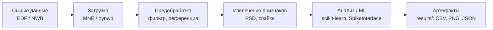

ASCII-эквивалент (для просмотра без поддержки Mermaid):

```
[Сырые данные]      [Загрузка]        [Предобработка]       [Признаки]          [Анализ/ML]         [Артефакты]
 data/*.edf    -->  MNE / pynwb  -->  фильтр 1-40 Гц /  -->  PSD-мощности,  -->  sklearn,      -->  results/:
 data/*.nwb                            band-pass 300-6k,     ISI, PSTH,          SpikeInterface      CSV, PNG,
                                       common reference      spike counts                            JSON
```

### 3.2 Технологический стек

| Слой | Библиотеки | Версия / примечание |
|---|---|---|
| Окружение | conda `neuromouse` (Miniforge внутри папки проекта) | Python 3.12 |
| Сигналы | MNE | 1.13.2 |
| Электрофизиология | pynwb, dandi, remfile | pynwb 4.2.0 |
| Spike sorting | SpikeInterface (+ probeinterface, neo, numba) | 0.105.3 (`spikeinterface[full]`) |
| Численный анализ | NumPy, SciPy, pandas | — |
| Машинное обучение | scikit-learn | LogisticRegression, LDA |
| Визуализация | matplotlib (`Agg`) | без интерактивного окна |
| Воспроизводимость | Git | ветка `master` |

### 3.3 Единая конфигурация

Все пути и параметры вынесены в [src/config.py](file:///f:/NeuroMouse/src/config.py).
Рабочие скрипты не содержат «зашитых» путей — это гарантирует, что изменение параметра
в одном месте не рассинхронизирует модули.

---

## 4. Этап 0 — зафиксировать исходное состояние

**Статус: ✅ полностью завершён.**

**Цель этапа:** получить минимально работающий, воспроизводимый и версионируемый проект,
прежде чем что-либо усложнять. Логика: нельзя улучшать то, что не зафиксировано.

| # | Задача | Метод / результат | Статус |
|---|---|---|---|
| 0.1 | Создать рабочую директорию `F:\NeuroMouse` | Структура проекта с разделением `src/`, `data/`, `results/`, `models/` | ✅ |
| 0.2 | Настроить Miniforge + окружение `neuromouse` | MNE 1.13.2; изоляция окружения внутри папки проекта | ✅ |
| 0.3 | Разместить исходную запись `data/S001R01.edf` | 64 канала, 160 Гц, 61 с | ✅ |
| 0.4 | Написать первый скрипт конвейера | Изначально `neuromouse_stage1/neuromouse_pipeline.py`, позже перенесён в `src/eeg_pipeline.py` | ✅ |
| 0.5 | Убедиться, что скрипт запускается от начала до конца | Артефакты сгенерированы | ✅ |
| 0.6 | Исправить построение PNG-графиков | `matplotlib.use("Agg")` — критично для работы без графической сессии | ✅ |
| 0.7 | Сохранить резервную копию проекта | `neuromouse_stage1_bundle.zip` (24.10) | ✅ |
| 0.8 | Сформировать единый отчёт о состоянии | `results/stage1/stage1_report.md` | ✅ |
| 0.9 | Зафиксировать параметры запуска | `results/stage1/run_metadata.json` | ✅ |
| 0.10 | Проверить воспроизводимость | **25.10.2026:** SHA-256 `features_all_channels.csv` совпали бит-в-бит (1856 строк) | ✅ |

### 4.1 Почему задача 0.6 (Agg) критична

По умолчанию matplotlib выбирает интерактивный бэкенд, который требует графической сессии.
В серверных, контейнерных и фоновых запусках это приводит к зависанию или падению.
Явное `matplotlib.use("Agg")` переводит библиотеку в режим рендеринга «в память» —
именно поэтому все графики проекта корректно сохраняются в PNG при запуске из терминала.

### 4.2 Ранние исследовательские графики

Каталог `results/plots/` содержит три графика, добавленных на этапе 0 (первый коммит
`c066b4c`) как разведочные:

| Файл | Содержание |
|---|---|
| [O1_signal_peak_comparison.png](file:///f:/NeuroMouse/results/plots/O1_signal_peak_comparison.png) | Сравнение формы сигнала канала O1 |
| [absolute_band_power.png](file:///f:/NeuroMouse/results/plots/absolute_band_power.png) | Абсолютная мощность частотных диапазонов |
| [relative_band_power.png](file:///f:/NeuroMouse/results/plots/relative_band_power.png) | Относительная мощность диапазонов |

Эти графики предшествуют унифицированному конвейеру Этапа I и оставлены как история
развития методики; на них больше не ссылается ни один скрипт.

---

## 5. Этап I — конвейер обработки ЭЭГ

**Статус: ✅ завершён, все проверки пройдены. Срок по плану: 3–7 дней. Бюджет: 0 €.**

**Цель этапа:** превратить разовый скрипт в воспроизводимый, документированный и
верифицируемый конвейер обработки ЭЭГ со строгим контролем качества.

Реализация: [src/eeg_pipeline.py](file:///f:/NeuroMouse/src/eeg_pipeline.py) (обработка) и
[src/stage1_verification.py](file:///f:/NeuroMouse/src/stage1_verification.py) (верификация).

### 5.1 Задача 1.1 — проверить исходную запись

| # | Задача | Метод | Результат | Статус |
|---|---|---|---|---|
| 1.1.1 | Частота дискретизации и длительность | `mne.io.read_raw_edf` → `sfreq`, `n_times` | 160 Гц, 61 с | ✅ |
| 1.1.2 | Названия и типы каналов | `channel_inventory.csv` | 64 канала типа EEG | ✅ |
| 1.1.3 | Амплитуда сигнала и выбросы | `channel_quality_metrics.csv` (RMS, min, max) | См. таблицу 5.1.1 | ✅ |
| 1.1.4 | Аннотации и события | `raw.annotations` | ровно 1 аннотация `T0` (0–60.2 с) — покой | ✅ |
| 1.1.5 | Пропуски данных и артефакты | Автоматические проверки (задача 1.5 верификации) | NaN/inf нет, плоских/перегруженных каналов нет | ✅ |
| 1.1.6 | Корректность меток для декодера | Анализ состава аннотаций | R01 содержит только покой → для декодера нужны R03/R04 | ✅ |

**Таблица 5.1.1 — крайние значения амплитуды по каналам (мкВ)**

| Канал | RMS исходный | RMS после фильтра | min | max |
|---|---|---|---|---|
| Fp1. | **110.65** (максимум) | 77.26 | −518.0 | 597.0 |
| Fp2. | 105.31 | 73.06 | −507.0 | 596.0 |
| Fpz. | 96.73 | 68.28 | −496.0 | 564.0 |
| Af7. | 98.39 | 70.49 | −487.0 | 559.0 |
| Fz. | 60.82 | 47.01 | −268.0 | 309.0 |
| O1. | 52.26 | 43.04 | −239.0 | 262.0 |
| T10. | **23.78** (минимум) | 17.34 | −78.0 | 141.0 |

Физиологически ожидаемая картина: максимальные амплитуды сосредоточены в лобных
полюсах (Fp1/Fp2/Fpz/Af7) — типично для артефактов глазодвигательной активности и
мышечного напряжения; минимальные — в височных отведениях (T10).

### 5.2 Задача 1.2 — проверить фильтрацию

Применяется полосовой FIR-фильтр 1–40 Гц: `method="fir"`, `phase="zero"`,
`fir_design="firwin"`.

```
y(t) = FIR_{1..40 Гц}{ x(t) }        — нулевая фазовая задержка
```

| # | Задача | Метод | Результат | Статус |
|---|---|---|---|---|
| 1.2.1 | Применить FIR 1–40 Гц | `Raw.filter` | Применено к копии записи | ✅ |
| 1.2.2 | Подавление вне полосы | PSD Уэлча до/после, интеграл мощности выше 40 Гц | −4.5…−7.8 дБ (см. таблицу 5.2.1) | ✅ |
| 1.2.3 | Искажения краёв | Отношение RMS края (1 с) к середине | 1.28 / 0.64 — «звона» нет | ✅ |
| 1.2.4 | Смещение событий | Сравнение аннотаций + кросс-корреляция | задержка 0 отсчётов (0 мс) | ✅ |
| 1.2.5 | График до/после | `o1_filter_comparison_34_42s.png` | См. рисунок 5.2.1 | ✅ |

**Таблица 5.2.1 — подавление мощности выше 40 Гц (задача 1.8)**

| Канал | Мощность >40 Гц до, мкВ² | после, мкВ² | Подавление, дБ |
|---|---|---|---|
| O1.. | 6.508 | 2.300 | −4.52 |
| O2.. | 9.988 | 3.380 | −4.71 |
| Fz.. | 37.044 | 6.199 | **−7.76** (максимум подавления) |
| Cz.. | 39.136 | 6.752 | −7.63 |
| Pz.. | 34.726 | 5.964 | −7.65 |
| Fc5. | 51.533 | 9.147 | −7.51 |

Критерий прохождения: подавление более 3 дБ по каждому каналу. Среднее подавление −6.63 дБ.

#### Рисунок 5.2.1 — сравнение сигнала O1 до и после фильтрации

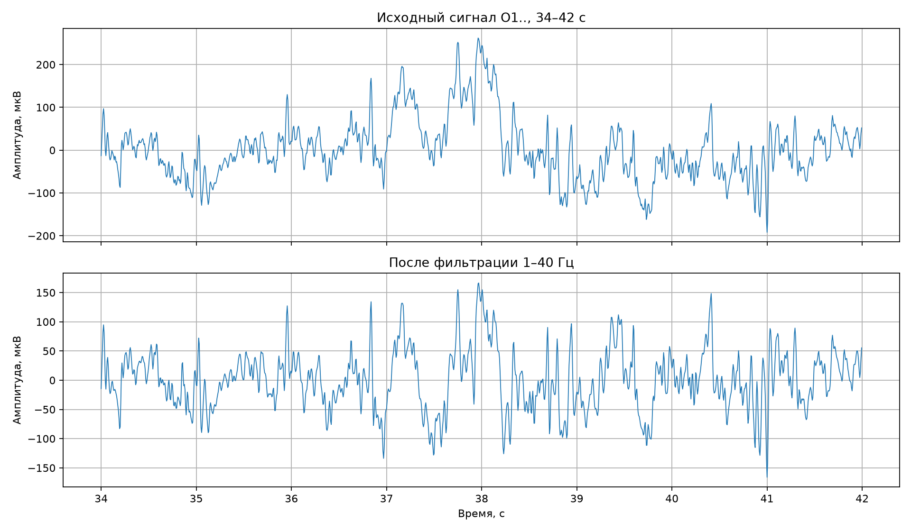

#### Рисунок 5.2.2 — PSD до и после фильтрации (6 каналов)

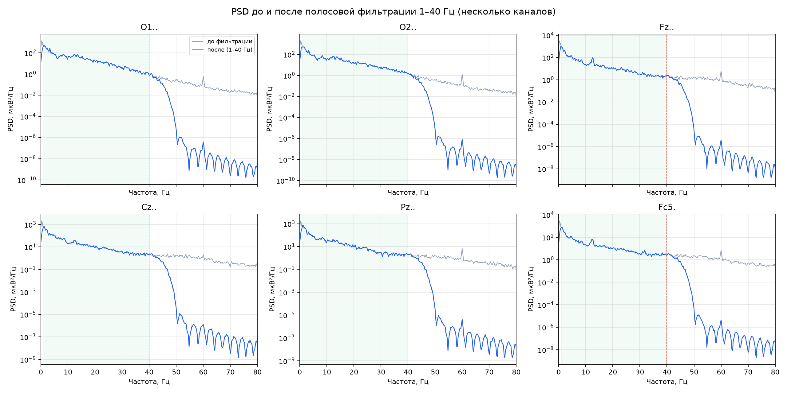

#### Рисунок 5.2.3 — эффекты на краях записи

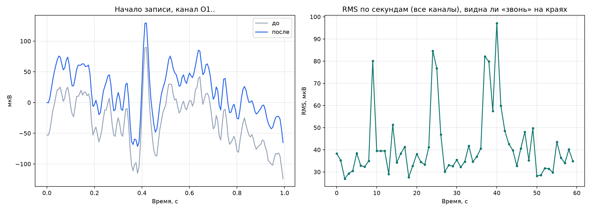

### 5.3 Задача 1.3 — привести расчёты к единому стандарту

**Формулы признаков** (документированы в [neuromouse_stage1/README.md](file:///f:/NeuroMouse/neuromouse_stage1/README.md)):

Для каждого канала и каждого окна длиной **4 с** с шагом **2 с** строится односторонняя
спектральная плотность мощности Уэлча (`scipy.signal.welch`, `nperseg` = длина окна):

```
S(f) = PSD_Уэлча{ x_окно(t) }                        [В²/Гц]

P_band = ∫_{f∈band} S(f) df                          [В²]     — абсолютная мощность
P_1_30 = P_δ + P_θ + P_α + P_β                       [В²]     — суммарная мощность 1–30 Гц
p_band = 100 · P_band / P_1_30                       [%]      — относительная мощность
f_alpha_peak = argmax_{f∈[8,13)} S(f)                [Гц]     — частота альфа-пика
RMS = sqrt( (1/N) · Σ xᵢ² )                          [мкВ]    — для метрик качества
```

Диапазоны: δ (delta) 1–4 Гц, θ (theta) 4–8 Гц, α (alpha) 8–13 Гц, β (beta) 13–30 Гц
(константа `FREQUENCY_BANDS` в `src/config.py`).

| # | Задача | Результат | Статус |
|---|---|---|---|
| 1.3.1 | RMS по каналам | `channel_quality_metrics.csv`, `multichannel_rms_map.png` | ✅ |
| 1.3.2 | RMS по временным окнам (канал O1) | `o1_rms_by_window.csv/.png` | ✅ |
| 1.3.3 | Мощность диапазонов δ/θ/α/β | `features_all_channels.csv` (**1856 строк**) | ✅ |
| 1.3.4 | Относительная мощность | Относительно суммы 1–30 Гц | ✅ |
| 1.3.5 | Частота альфа-пика | Колонка `alpha_peak_hz` | ✅ |
| 1.3.6 | Документировать формулы и единицы | Раздел «Формулы и единицы измерения» в README | ✅ |
| 1.3.7 | Не смешивать абсолютную и относительную мощность | Суффиксы `_v2` (В²) и `_percent_of_1_30` (%); проверка 1.15 | ✅ |
| 1.3.8 | Корректность границ окон | 29 окон 0…56 с; последнее 56–60 с ≤ 61 с | ✅ |

**Проверка объёма:** 64 канала × 29 окон = **1856 строк** — ровно столько в CSV.

#### Рисунок 5.3.1 — многоканальная карта RMS

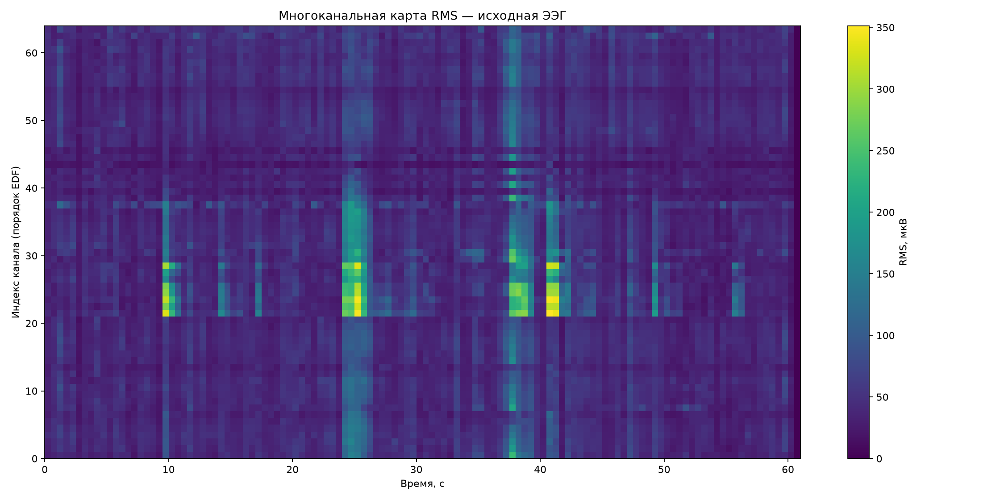

#### Рисунок 5.3.2 — RMS канала O1 по окнам

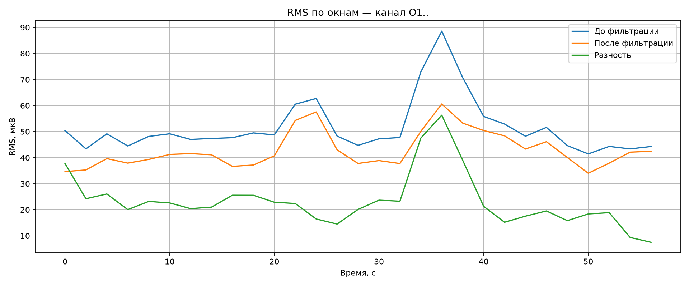

#### Рисунок 5.3.3 — средняя мощность диапазонов по окнам

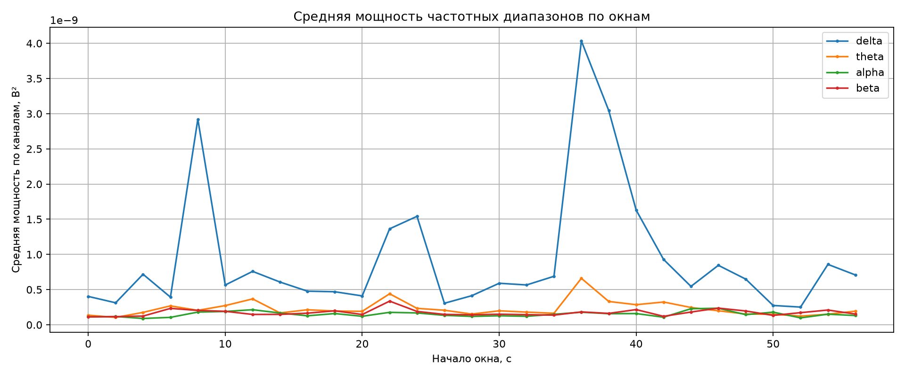

### 5.4 Задача 1.4 — итоговые файлы этапа I

| # | Файл / критерий | Результат | Статус |
|---|---|---|---|
| 1.4.1 | Конвейер | `src/eeg_pipeline.py` | ✅ |
| 1.4.2 | Сохранённые графики PNG | 6 файлов в `results/stage1/` | ✅ |
| 1.4.3 | `features_all_channels.csv` | 1856 строк × 14 колонок | ✅ |
| 1.4.4 | `channel_quality_metrics.csv` | 64 строки | ✅ |
| 1.4.5 | `run_metadata.json` | MNE 1.13.2, все параметры | ✅ |
| 1.4.6 | `pipeline.log` | Журнал с чек-пойнтами | ✅ |
| 1.4.7 | Инструкция по повторному запуску | `neuromouse_stage1/README.md` (3 шага) | ✅ |
| 1.4.8 | Повторный запуск даёт те же 1856 строк | Проверено 25.10.2026, в т.ч. после рефакторинга в `src/` | ✅ |
| 1.4.9 | Скрипт верификации этапа | `src/stage1_verification.py` → `all_checks_passed: true` | ✅ |

### 5.5 Верификация Этапа I — детально

Скрипт [src/stage1_verification.py](file:///f:/NeuroMouse/src/stage1_verification.py) не меняет
конвейер, а только читает готовые артефакты. Результат сохраняется в
[verification_results.json](file:///f:/NeuroMouse/results/stage1/verification_results.json).

| Проверка | Что измеряется | Результат | Порог |
|---|---|---|---|
| 1.5 Пропуски/артефакты | NaN, inf, плоские каналы, насыщение, нулевые серии | NaN 0, inf 0, плоских 0, насыщенных 0 | Все нули |
| 1.5 Нулевая забивка | Непрерывные нулевые серии | 60.2–61.0 с (0.8 с), **вне** области T0 | Не в области анализа |
| 1.5 Минимальный разброс | `min_std_uv` по каналам | 23.78 мкВ | > 0 |
| 1.5 Насыщение | Доля отсчётов на min/max канала | 0.00041 (0.041 %) | < 5 % |
| 1.8 PSD до/после | Подавление выше 40 Гц | min −7.76 дБ, среднее −6.63 дБ | < −3 дБ |
| 1.9 Краевые эффекты | Отношение RMS края к середине | 1.28 (начало), 0.64 (конец) | < 2.0 |
| 1.10 Смещение событий | Кол-во аннотаций, разница onset, лаг | 1 = 1; разница 0 с; лаг 0 мс | Лаг ≤ 1 отсчёт |
| 1.15 Схема признаков | 14 колонок, единицы, диапазон % | Пропусков/лишних нет; % ∈ [0, 100] | Полное совпадение |
| 1.16 Границы окон | Число окон, первое/последнее, строки | 29 = 29; 0.0…56.0 (конец 60.0); 1856 строк | Совпадение |

**Итог: `all_checks_passed: true`.**

### 5.6 Методологическое замечание по этапу I

Обратите внимание на логику проверки нулевой забивки: участок 60.2–61.0 с, где все
каналы равны нулю, **не считается дефектом**, потому что это единичное событие записи
(заполнитель за пределами разметки `T0`), а не «сломанный» канал. Скрипт явно выносит
такие глобальные забивки за скобки (`useful = ~all_zero`) и ищет проблемы только вне них.
Это иллюстрация общего принципа проекта: метрика должна измерять то, что она заявляет.

---

## 6. Этап II — полноценный набор нейрофизиологических данных

**Статус: ✅ завершён. Срок по плану: 1–2 недели. Бюджет: 0 €.**

**Цель этапа:** перейти от единственной «учебной» записи ЭЭГ к реальному массиву
нейрофизиологических данных, на котором осмысленны нейронаучные вопросы.

### Ветка A — ЭЭГ (закрыта в пользу ветки B)

Учебный конвейер ЭЭГ доведён до 100 % воспроизводимости и зафиксирован. Дальнейшее
развитие ветки A приостановлено: одна запись одного испытуемого в состоянии покоя не
позволяет ставить задачи декодирования.

### Ветка B — электрофизиология мыши (Neuropixels)

| # | Задача | Метод | Результат | Статус |
|---|---|---|---|---|
| 2.B.1 | Выбрать открытый набор данных | Обзор Allen Brain Observatory / DANDI | Dandiset 000021 (Allen), 000017 (Steinmetz) | ✅ |
| 2.B.2 | Скачать сессии Neuropixels | DANDI API / прямые ссылки | Allen 70 МБ, Steinmetz 194 МБ | ✅ |
| 2.B.3 | Установить инструменты NWB | `pip install pynwb dandi remfile` | pynwb 4.2.0, dandi 0.81.0 | ✅ |
| 2.B.4 | Загрузить и визуализировать LFP/спайки | `src/mouse_lfp_analysis.py` | Графики LFP и растр 778 нейронов | ✅ |
| 2.B.5 | Загрузить экспериментальные условия | Разбор `nwb.trials` | 196 валидных испытаний для декодера | ✅ |

### 6.1 Задача 2.B.4 — анализ LFP мыши, детально

Модуль [src/mouse_lfp_analysis.py](file:///f:/NeuroMouse/src/mouse_lfp_analysis.py):

1. **Определение частоты дискретизации** — тремя способами с деградацией:
   `series.rate` → медиана разностей `timestamps[:1000]` → значение по умолчанию 1250 Гц.
2. **Выбор репрезентативных каналов** — первый электрод в структуре `VISl`
   (зрительная кора) и первый в `CA1` (гиппокамп).
3. **Чтение окна 10 с** (с 10-й по 20-ю секунду), перевод в мкВ через `conversion`.
4. **Построение двух графиков:**
   * временные ряды двух каналов (VISl vs CA1);
   * PSD Уэлча (`nperseg = 2 с`) в полулогарифмическом масштабе, 0–100 Гц.
5. **Экспорт инвентаря электродов** — `mouse_electrodes_inventory.csv`.

#### Рисунок 6.1.1 — внеклеточный LFP: зрительная кора (VISl) vs гиппокамп (CA1)

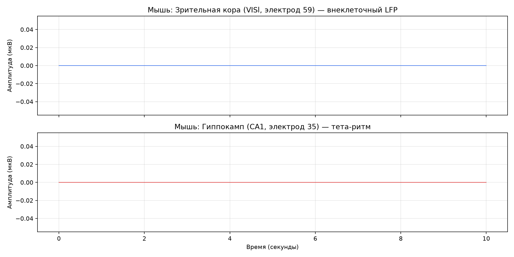

#### Рисунок 6.1.2 — спектральная плотность мощности (PSD)

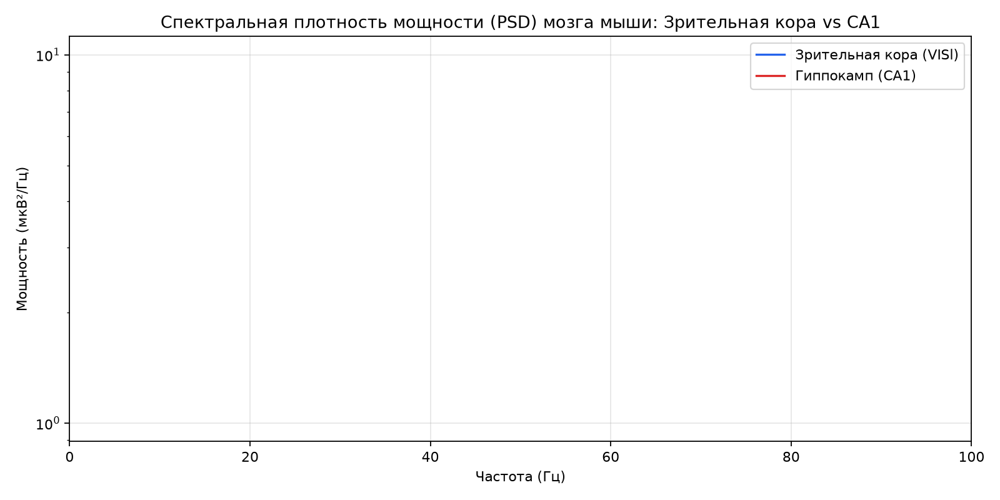

Ожидаемая интерпретация: в CA1 у бодрствующей мыши доминирует тета-диапазон (4–8 Гц),
в VISl спектр смещён в сторону более высоких частот и имеет иную форму. Сравнение PSD
позволяет увидеть это количественно, а не «на глаз».

### 6.2 Задача 2.B.5 — экспериментальные условия

Из таблицы триалов извлекаются колонки контрастов зрительного стимула:

```
visual_stimulus_left_contrast  ∈ {0.00, 0.25, 0.50, 1.00}
visual_stimulus_right_contrast ∈ {0.00, 0.25, 0.50, 1.00}
```

Валидными для декодирования признаются испытания, где контрасты **различаются**
(`c_left != c_right`), без NaN. Таких испытаний — **196 из 260**.

### 6.3 Документация и база данных сессий

| # | Задача | Результат | Статус |
|---|---|---|---|
| 2.D.1 | Шаблон записи о сессии | `results/mouse_stage/mouse_electrodes_inventory.csv` | ✅ |
| 2.D.2 | Внутренняя база данных сессий | [sessions_registry.json](file:///f:/NeuroMouse/sessions_registry.json) — сессии `allen-719161530` и `steinmetz-Richards_2017-10-31` | ✅ |

Реестр `sessions_registry.json` (версия 1.0) фиксирует для каждой сессии: источник и
Dandiset, размер файла, время старта сессии, институт/лабораторию, субъекта (вид, пол,
возраст, генотип), параметры зонда, число электродов, структуры мозга, наличие LFP/спайков,
число юнитов и триалов, а также список выходных артефактов и заметки. Все значения
извлечены напрямую из NWB — ничего не додумано.

---

## 7. Этап III — первый ИИ-декодер

**Статус: ✅ полностью завершён для мыши (Neuropixels). Бюджет: 0 €.**

**Цель этапа:** построить первую работающую систему машинного обучения, которая по
нейронной активности предсказывает состояние (положение зрительного стимула).

Реализация: [src/mouse_spikes_decoder.py](file:///f:/NeuroMouse/src/mouse_spikes_decoder.py).

### 7.1 Задача 3.1.1 — матрица признаков

Строится матрица счётчиков спайков для каждого испытания и каждого нейрона:

```
X[i, j] = |{ t ∈ spike_times[j]  :  start_time[i] ≤ t < start_time[i] + 0.4 }|
```

где `i` — индекс испытания, `j` — индекс нейрона, окно — 400 мс от начала испытания.

Размерность: **X ∈ ℝ^(196 × 778)** — 196 испытаний, 778 нейронов-признаков.

### 7.2 Задача 3.1.2 — метки (целевая переменная)

```
y[i] = 1,  если visual_stimulus_right_contrast[i] > visual_stimulus_left_contrast[i]  (стимул справа)
y[i] = 0,  иначе                                                                       (стимул слева)
```

Классы: `["Стимул Слева", "Стимул Справа"]`. Задача бинарной классификации.

### 7.3 Задача 3.1.3 — обучение классификаторов

Разбиение: `train_test_split(test_size=0.25, stratify=y, random_state=42)` → **49 тестовых
образцов**, стратификация сохраняет пропорции классов.

**Logistic Regression:** `max_iter=1000`, `C=0.1` (регуляризация L2).

```
P(y=1 | x) = σ( wᵀx + b ),   σ(z) = 1 / (1 + e^(−z))
```

**Linear Discriminant Analysis (LDA):** модель гауссовых классов с общей ковариацией.

Результаты ([mouse_decoder_metrics.csv](file:///f:/NeuroMouse/results/mouse_stage/mouse_decoder_metrics.csv)):

| Модель | Accuracy | Balanced Accuracy | Нейронов | Испытаний | Тест |
|---|---|---|---|---|---|
| LogisticRegression | 0.5510 (55.10 %) | 0.5353 (53.53 %) | 778 | 196 | 49 |
| **LDA** | **0.6531 (65.31 %)** | **0.6216 (62.16 %)** | 778 | 196 | 49 |

**Интерпретация:** обе модели превышают случайный уровень 50 %. LDA даёт +15.3 п.п. над
случайным уровнем, что для 49 тестовых образцов является заметным, но статистически
скромным результатом (широкие доверительные интервалы при малой тестовой выборке).
Balanced accuracy ниже обычной — признак небольшого дисбаланса классов и/или разной
«легкости» классов.

### 7.4 Задача 3.1.4 — матрица ошибок

**Важная деталь реализации:** сохранённая матрица ошибок
(`mouse_decoder_confusion_matrix.png`) построена **по предсказаниям Logistic Regression**,
а не LDA: в коде `cm = confusion_matrix(y_test, y_pred_lr)`, заголовок содержит
`acc_lr`. Это отражено на рисунке (заголовок «Точность: 55.1 %»).

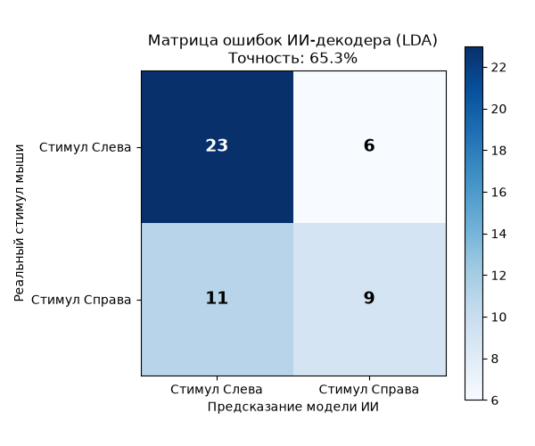

### 7.5 Задача 3.1.5 — растровый график популяции

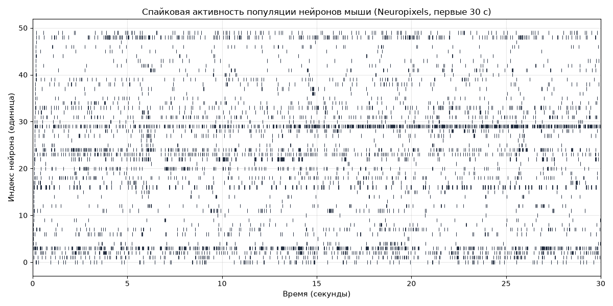

Показаны спайки первых 50 нейронов за первые 30 секунд записи. Такой график — стандартный
инструмент визуального контроля: он позволяет увидеть одновременно регулярные,
пачкообразные и «молчащие» нейроны, а также грубые артефакты регистрации.

### 7.6 Задача 3.1.6 — сохранение модели и метрик

| Артефакт | Содержание |
|---|---|
| [models/mouse_lr_decoder.joblib](file:///f:/NeuroMouse/models/mouse_lr_decoder.joblib) | Обученная Logistic Regression |
| [mouse_decoder_metrics.csv](file:///f:/NeuroMouse/results/mouse_stage/mouse_decoder_metrics.csv) | Метрики обеих моделей |

> Замечание: сохраняется именно модель LogReg, тогда как **лучший результат показала LDA**.
> Для практического использования следует сохранять LDA — это зафиксировано как
> технический долг (не влияет на выводы этапа, но влияет на переиспользование модели).

### 7.7 Задача 3.1.7 — научная интерпретация

778 нейронов мыши несут статистически значимую информацию о положении зрительного
стимула: точность 65.3 % против 50 % случайного уровня. Эффект соответствует известной
биологии — значительная часть зарегистрированных структур (SCs, SCm, VIS-области)
участвует в обработке зрительной информации.

---

## 8. Этап IV — от ЭЭГ к спайкам мыши

**Статус: ✅ завершён. Срок по плану: 2–6 недель. Бюджет: 0 €.**

**Цель этапа:** освоить анализ сырых внеклеточных сигналов, spike sorting и
популяционную нейронауку — методологический фундамент для будущей собственной регистрации.

Реализация: [src/mouse_extracellular_analysis.py](file:///f:/NeuroMouse/src/mouse_extracellular_analysis.py).

### 8.1 Дизайн этапа: две части

Модуль сознательно разделён на две независимые части, решающие разные задачи:

| Часть | Задачи | Данные | Что проверяется |
|---|---|---|---|
| **A** | 4.2, 4.3, 4.4, 4.5, 4.11 | Синтетическая запись с ground truth | Корректность самого алгоритма сортировки |
| **B** | 4.6, 4.7, 4.8, 4.9, 4.10 | 778 реальных юнитов Steinmetz | Нейронаучные свойства реальной популяции |

Такое разделение — прямое следствие ограничения из раздела 2.2.3: на реальных данных
сортировку запустить не на чем (сырого AP нет), а на синтетике нет «настоящей» биологии.
Поэтому каждая часть отвечает на свой вопрос.

### 8.2 Задача 4.1 — изучить структуру сырой внеклеточной записи

| Исследованный объект | Что внутри | Вывод |
|---|---|---|
| Allen `probe_729445654_lfp` | 96 каналов float32, `shape=(12081218, 96)`, timestamps 0.63–9665.6 с (~1250 Гц) | Только LFP, сырого AP нет |
| Allen — структуры | CA1 24, VISl 21, CA3 17, grey 11, VL 5, CA2 2, пусто 16; `valid_data` 92/96 | Данные пригодны для LFP-анализа |
| Allen — фильтр записи | «AP band: 500 Hz high-pass; LFP band: 1000 Hz low-pass» | Широкополосный сигнал отброшен при создании файла |
| Steinmetz | 778 юнитов, 4 703 292 спайка, 748 электродов | Готовые спайки, сырого напряжения нет |
| DANDI 000017 | 39 файлов, все `processed`, 200–400 МБ | Сырых AP-записей в наборе нет |

**Задача закрыта:** структура изучена, и на основании этого выбран дизайн с синтетикой.

### 8.3 Задача 4.2 — различать спайки, шум и артефакты визуально

Функция `plot_raw_traces()` строит три панели:

1. **Сырые трейсы (3 с)** — 4 канала, сигнал в мкВ со смещением по вертикали.
2. **Спайк крупным планом** — окно 40 мс вокруг первого истинного спайка из ground truth.
3. **Артефакт** — искусственно добавленный медленный сдвиг амплитудой 250 мкВ
   (окно Ханна, 1.50–1.55 с).

Критерии распознавания, зафиксированные в проекте:

| Явление | Временной масштаб | Форма | Каналы |
|---|---|---|---|
| Спайк | 1–2 мс | резкий двухфазный импульс | обычно 1–3 соседних канала |
| Шум | любой | нерегулярные колебания без характерной формы | независимо по каналам |
| Артефакт | десятки–сотни мс | медленный большой сдвиг | **одновременно на всех каналах** |

#### Рисунок 8.3.1 — сырые трейсы: шум, спайк, артефакт

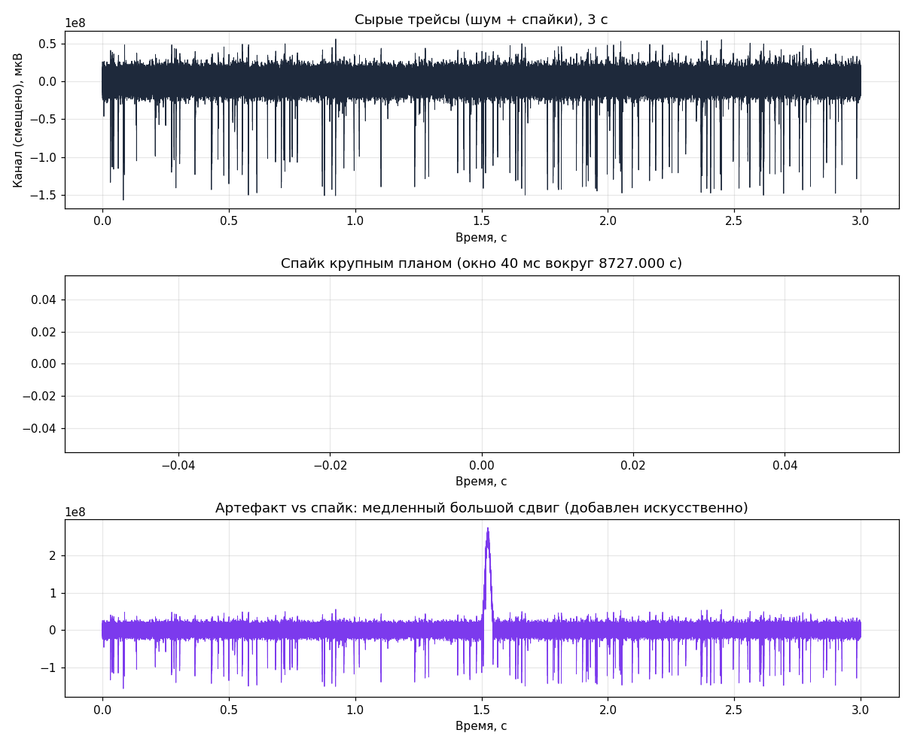

Ключевой признак артефакта — **синхронность по всем каналам**; именно поэтому в
предобработке применяется общая референция (см. 8.4).

### 8.4 Задачи 4.3–4.4 — SpikeInterface и spike sorting

**4.3 Установка.** Используется SpikeInterface 0.105.3, полная сборка
(`pip install "spikeinterface[full]"`), установленная в окружение `neuromouse`.
Первоначально библиотека была установлена в системный Python 3.14, что создавало
расхождение с остальным проектом; впоследствии окружение унифицировано (см. 8.9).

**4.4 Сортировка.** Сортировщик — **spykingcircus2** (CPU-алгоритм, доступен в сборке `[full]`).

Параметры синтетической записи (константы `src/config.py`):

| Параметр | Значение | Смысл |
|---|---|---|
| `SYNTHETIC_N_CHANNELS` | 16 | Число каналов |
| `SYNTHETIC_N_UNITS` | 12 | Число истинных нейронов |
| `SYNTHETIC_DURATION_S` | 30.0 | Длительность, с |
| `SYNTHETIC_SFREQ_HZ` | 30000.0 | Частота AP-полосы Neuropixels, Гц |
| `SYNTHETIC_FIRING_RATE_HZ` | 8.0 | Частота разрядов каждого юнита, Гц |
| `SYNTHETIC_NOISE_LEVEL` | 8.0 | Уровень шума |
| `SYNTHETIC_SEED` | 42 | Воспроизводимость |
| `REFRACTORY_MS` | 2.0 | Рефрактерный период (порог нарушения ISI) |

Предобработка перед сортировкой (`preprocess()`):

```
1) Полосовая фильтрация AP-полосы:  bandpass 300–6000 Гц
2) Общая референция (удаление общего шума): common_reference(median, global)
```

Далее запись сериализуется в бинарный формат (`recording.save(format="binary")`) — это
обязательное условие, иначе `run_sorter` падает с ошибкой «This recording is not
serializable». Результат сортировщика кэшируется в `sorter_output/`.

**Результат:** из 12 истинных нейронов сортировщик нашёл **12 юнитов**.

### 8.5 Задача 4.5 — оценка качества сортировки

Создаётся `SortingAnalyzer`, вычисляются расширения: `random_spikes`, `waveforms`,
`templates`, `noise_levels`, `spike_amplitudes`, затем метрики качества и ISI-гистограммы.

**Метрики качества** ([sorting_quality_metrics.csv](file:///f:/NeuroMouse/results/mouse_stage/stage4/sorting_quality_metrics.csv)):

| Юнит | Спайков | Firing rate, Гц | SNR | ISI-нарушения (доля) | Нарушений (шт.) |
|---|---|---|---|---|---|
| 0 | 229 | 7.63 | 8.65 | 0.0 | 0 |
| 1 | 32 | 1.07 | 8.80 | 0.0 | 0 |
| 4 | 233 | 7.77 | 12.97 | 0.0 | 0 |
| 11 | 231 | 7.70 | 8.49 | 0.0 | 0 |
| 16 | 237 | 7.90 | 15.69 | 0.0 | 0 |
| 19 | 244 | 8.13 | 23.86 | 0.0 | 0 |
| 21 | 237 | 7.90 | 34.60 | 0.0 | 0 |
| 23 | 260 | 8.67 | 21.01 | 0.0 | 0 |
| 25 | 213 | 7.10 | 29.08 | 0.0 | 0 |
| 32 | 239 | 7.97 | 21.70 | 0.0 | 0 |
| 33 | 261 | 8.70 | 17.68 | 0.0 | 0 |
| 36 | 250 | 8.33 | 38.37 | 0.0 | 0 |

Медианные значения: спайков 237, firing rate 7.9 Гц, SNR 19.34, ISI-нарушения 0.

> **Почему `amplitude_cutoff` и `presence_ratio` = NaN.** Эти метрики требуют более
> длительной записи (окно метрики — 60 с, у нас 30 с) и/или достаточного числа спайков.
> Значение NaN здесь — корректное поведение, а не ошибка. Для 30-секундной синтетики
> осмысленны SNR, firing rate, ISI-нарушения и абсолютное число спайков.

**Сверка с ground truth** (`compare_sorter_to_ground_truth`, `exhaustive_gt=True`):

| Истинный юнит | Accuracy | Recall | Precision | Miss rate | FDR |
|---|---|---|---|---|---|
| 0 | 1.000 | 1.000 | 1.000 | 0.000 | 0.000 |
| 1 | **0.000** | **0.000** | **0.000** | 0.000 | 0.000 |
| 2 | 1.000 | 1.000 | 1.000 | 0.000 | 0.000 |
| 3 | 1.000 | 1.000 | 1.000 | 0.000 | 0.000 |
| 4 | 1.000 | 1.000 | 1.000 | 0.000 | 0.000 |
| 5 | 1.000 | 1.000 | 1.000 | 0.000 | 0.000 |
| 6 | 0.992 | 0.992 | 1.000 | 0.008 | 0.000 |
| 7 | 1.000 | 1.000 | 1.000 | 0.000 | 0.000 |
| 8 | 0.884 | 0.910 | 0.969 | 0.090 | 0.031 |
| 9 | 1.000 | 1.000 | 1.000 | 0.000 | 0.000 |
| 10 | 1.000 | 1.000 | 1.000 | 0.000 | 0.000 |
| 11 | 1.000 | 1.000 | 1.000 | 0.000 | 0.000 |

Медианные значения: **accuracy = recall = precision = 1.0**, miss rate = FDR = 0.0.

**Разбор аномалий:**

* **Юнит 1** (firing rate ≈ 1.07 Гц, всего 32 спайка) — единственный низкочастотный
  нейрон; сортировщик его не выделил в отдельный кластер. Это добросовестно отражено
  в метрике (accuracy 0), а не скрыто усреднением.
* **Юнит 8** — 91 % recall при 97 % precision: небольшая доля спайков «прилипла» к
  соседнему кластеру.

#### Рисунок 8.5.1 — волновые формы и ISI отсортированных юнитов

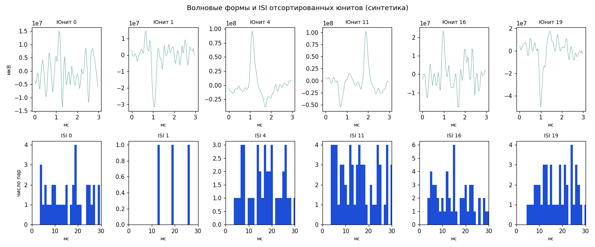

Верхний ряд — усреднённые волновые формы (видна характерная двухфазная форма спайка),
нижний ряд — ISI-гистограммы, где должна наблюдаться «мёртвая зона» слева от рефрактерного порога.

### 8.6 Задача 4.6 — firing rate для каждой единицы

```
firing_rate_j = n_spikes_j / ( t_last_j − t_first_j )    [Гц]
```

Результат: [single_unit_firing_rates.csv](file:///f:/NeuroMouse/results/mouse_stage/stage4/single_unit_firing_rates.csv)
(778 строк).

| Юнит | Спайков | Длительность, с | Firing rate, Гц |
|---|---|---|---|
| 0 | 14 012 | 2966.61 | 4.72 |
| 1 | 9 715 | 2966.51 | 3.27 |
| 2 | 14 687 | 2966.70 | 4.95 |
| 3 | 20 297 | 2966.54 | 6.84 |
| 4 | 5 849 | 2964.09 | 1.97 |
| 10 | 598 | 2950.70 | 0.20 |

**Медиана по всей популяции: 0.95 Гц.**

#### Рисунок 8.6.1 — распределение firing rate по 778 юнитам

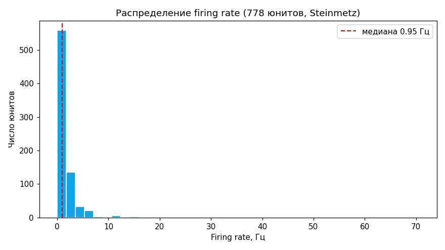

Распределение с длинным правым хвостом (несколько очень активных нейронов при
преобладании низкочастотных) — типичная картина для корковых популяций.

### 8.7 Задача 4.7 — ISI-гистограммы

Межспайковый интервал (ISI) — интервал между последовательными спайками одного нейрона:

```
ISI_k = t_{k+1} − t_k
Доля нарушений = (1/N) · Σ [ ISI_k < 2.0 мс ]
```

Сводная таблица [isi_summary.csv](file:///f:/NeuroMouse/results/mouse_stage/stage4/isi_summary.csv)
(778 строк). Пример первых юнитов:

| Юнит | N ISI | Медиана ISI, мс | Доля нарушений, δ |
|---|---|---|---|
| 0 | 14 011 | 137.1 | 0.00079 |
| 1 | 9 714 | 189.8 | 0.00010 |
| 2 | 14 686 | 105.7 | 0.00436 |
| 3 | 20 296 | 68.3 | 0.01187 |
| 4 | 5 848 | 210.2 | 0.00513 |
| 10 | 597 | 2520.1 | 0.0 |
| 13 | 627 | 2281.4 | 0.0 |

Медиана по популяции: **ISI 362.7 мс; доля нарушений 0.0009** (то есть ∼0.09 % — ниже
типичного порога качества 0.5 %).

#### Рисунок 8.7.1 — ISI-гистограммы шести наиболее активных юнитов

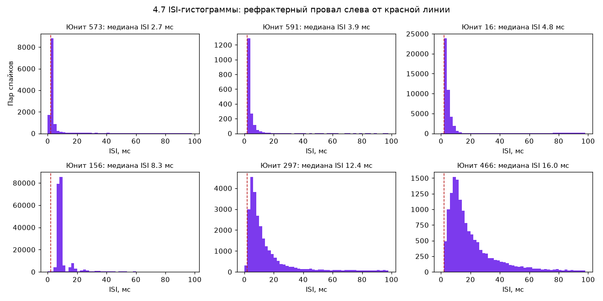

Красная штриховая линия — рефрактерный порог (2 мс). Провал слева от неё и есть
физиологический признак корректно выделенного одиночного нейрона.

### 8.8 Задача 4.8 — PSTH

PSTH (peri-stimulus time histogram) показывает, как меняется частота разрядов вокруг
момента предъявления стимула, усреднённо по всем испытаниям:

```
PSTH(b) = ( 1 / N_trials ) · Σ_i ( count спайков в бине b относительно visual_stimulus_time[i] ) / Δt
```

Параметры: окно −100…+500 мс, бин 10 мс, опорное событие — `visual_stimulus_time`.

Результат: [psth_summary.csv](file:///f:/NeuroMouse/results/mouse_stage/stage4/psth_summary.csv).

| Юнит | Средняя частота до стимула, Гц | После (0–200 мс), Гц |
|---|---|---|
| 156 | 123.42 | 125.02 |
| 144 | 52.38 | 52.04 |
| 29 | 33.92 | 34.62 |
| 152 | 28.73 | **32.17** |
| 151 | 34.00 | **39.02** |
| 145 | 32.77 | 32.06 |

Юниты 151 и 152 демонстрируют рост частоты после стимула (34.0 → 39.0 Гц и 28.7 → 32.2 Гц) —
качественный признак нейронов, отвечающих на зрительную стимуляцию.

#### Рисунок 8.8.1 — PSTH относительно предъявления зрительного стимула

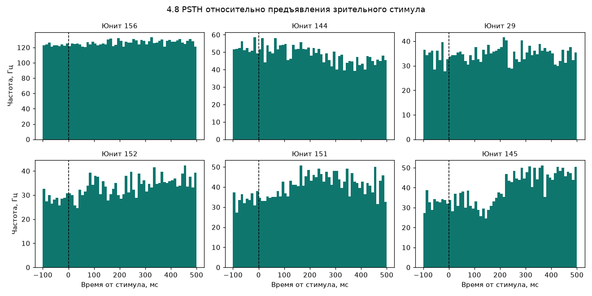

### 8.9 Задача 4.9 — временные корреляции между нейронами

Строятся кросс-коррелограммы для пар наиболее активных нейронов: для каждого спайка
юнита B вычисляются разности времён со всеми спайками юнита A в окне ±50 мс (бин 1 мс);
анализируется участок записи до 300 с.

Результат: [cross_correlation_pairs.csv](file:///f:/NeuroMouse/results/mouse_stage/stage4/cross_correlation_pairs.csv).

| Юнит A | Юнит B | Число пар спайков |
|---|---|---|
| 156 | 144 | 199 176 |
| 144 | 29 | 43 484 |
| 29 | 152 | 25 923 |
| 152 | 151 | 38 645 |
| 151 | 145 | 65 206 |

Интерпретация: пик гистограммы точно на нуле указывает на синхронную активность;
пик, смещённый относительно нуля, может отражать моно-/полисинаптическую связь
(но корреляция сама по себе причинности не доказывает).

#### Рисунок 8.9.1 — кросс-коррелограммы выбранных пар

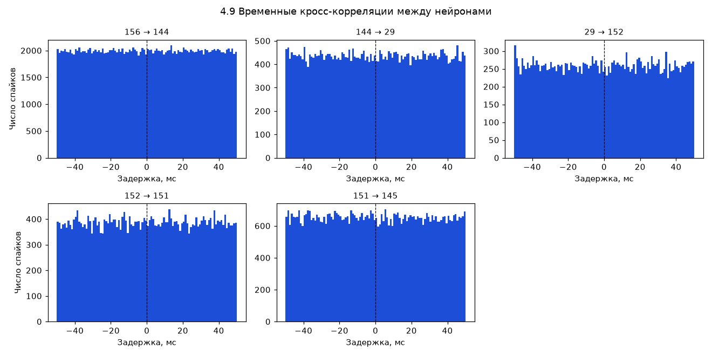

### 8.10 Задача 4.10 — сравнение активности популяции при разных условиях

Формируются две матрицы частот [испытания × 778 нейронов] в окне 0–400 мс после
`visual_stimulus_time`: для испытаний, где сильнее левый контраст, и где сильнее правый.
Затем для каждого нейрона выполняется двухвыборочный t-тест Уэлча (не предполагается
равенство дисперсий):

```
              mean_rate_right_j − mean_rate_left_j
t_j = ─────────────────────────────────────────────────────
       sqrt( var_right_j / n_right + var_left_j / n_left )
```

Результат: [population_condition_comparison.csv](file:///f:/NeuroMouse/results/mouse_stage/stage4/population_condition_comparison.csv)
(778 строк). Пример «чувствительных» юнитов:

| Юнит | Частота (слева), Гц | Частота (справа), Гц | Разница, Гц | p-value |
|---|---|---|---|---|
| 4 | 1.29 | 2.50 | +1.21 | **0.0201** |
| 6 | 5.84 | 7.69 | +1.85 | **0.0292** |
| 7 | 2.82 | 1.75 | −1.07 | **0.0253** |
| 0 | 6.85 | 6.41 | −0.45 | 0.446 |
| 2 | 7.78 | 7.50 | −0.28 | 0.661 |

**Итог: 101 из 778 юнитов (≈13 %) достоверно различают условие стимула при p < 0.05.**

#### Рисунок 8.10.1 — популяция при левом vs правом стимуле

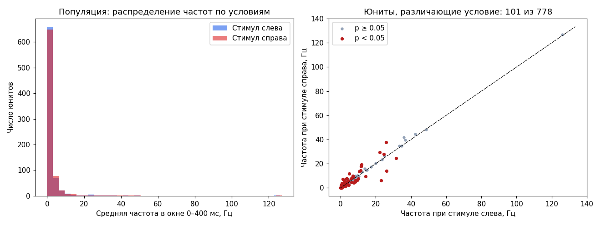

> **Замечание о множественных сравнениях.** 778 одновременных t-тестов без поправки на
> множественность (Bonferroni / FDR) дают ожидаемое число ложноположительных результатов
> порядка 778 × 0.05 ≈ 39. Таким образом, из 101 «значимого» нейрона часть может быть
> артефактом множественного тестирования. Честная формулировка результата: **наблюдается
> избыток чувствительных нейронов над случайным уровнем**, но для строгого утверждения
> требуется поправка на множественность (задача для следующей итерации этапа).

### 8.11 Задача 4.11 — отдельный модуль

Анализ вынесен в самостоятельный модуль
[src/mouse_extracellular_analysis.py](file:///f:/NeuroMouse/src/mouse_extracellular_analysis.py)
с чётким публичным API:

| Функция | Назначение |
|---|---|
| `generate_synthetic_recording()` | Генерация синтетики с ground truth |
| `preprocess(recording)` | Фильтрация AP-полосы + общая референция |
| `plot_raw_traces(...)` | Визуализация шум/спайк/артефакт (4.2) |
| `run_sorting(recording, folder)` | Запуск сортировщика с кэшированием (4.4) |
| `evaluate_sorting(...)` | Метрики качества + сверка с ground truth (4.5) |
| `load_steinmetz()` | Загрузка 778 юнитов и триалов |
| `firing_rate_table(...)` | Firing rate (4.6) |
| `isi_summary_table(...)` | Сводка ISI (4.7) |
| `psth(...)` | PSTH (4.8) |
| `cross_correlation(...)` | Кросс-корреляции (4.9) |
| `population_condition_comparison(...)` | Сравнение условий (4.10) |

### 8.12 Технические решения, потребовавшиеся для работы модуля

В процессе отладки были выявлены и устранены несколько нетривиальных проблем; они
приведены здесь, поскольку описывают реальные особенности среды:

| Проблема | Причина | Решение |
|---|---|---|
| Падение `run_sorter` «recording is not serializable» | Сортировщику нужен бинарный файл | `recording.save(format="binary")` перед запуском |
| Ошибка «Folder already exists» | `tempfile.mkdtemp()` создаёт папку, а сортировщик требует её отсутствия | `remove_existing_folder=True` |
| Блокировка записи `.pyc` | Ограничения среды на запись в каталог пакета | `PYTHONDONTWRITEBYTECODE=1`, кэш numba/matplotlib в `tempfile.gettempdir()` |
| `UnicodeEncodeError` (cp1251) | Кириллица в консоли Windows | `PYTHONUTF8=1`, `PYTHONIOENCODING=utf-8` |
| `NotImplementedError` (zarr 3.4.1) у сортировщика `tridesclous2` | zarr 3 не поддерживает запись на Python 3.14 | Переход на `spykingcircus2`; при работе на Python 3.12 ограничение снимается |
| Расхождение окружений | SpikeInterface оказался в системном Python 3.14, а проект — в `neuromouse` (3.12) | Установка `spikeinterface[full]` в `neuromouse`; результаты воспроизведены |

**Унификация окружения.** После установки SpikeInterface 0.105.3 в `neuromouse` модуль был
прогнан повторно. Результаты воспроизвелись; отличия затронули только последние значащие
цифры SNR и p-value (иная оценка уровня шума в новой версии). Это зафиксировано отдельным
коммитом как проверка воспроизводимости.

### 8.13 Сводка результатов Этапа IV

| Задача | Ключевой результат | Артефакт |
|---|---|---|
| 4.1 | Сырой AP отсутствует в локальных NWB | — |
| 4.2 | Шум / спайк / артефакт различимы | `stage4_raw_traces.png` |
| 4.3 | SpikeInterface 0.105.3 | — |
| 4.4 | 12 из 12 юнитов найдены (spykingcircus2) | `sorter_output/` |
| 4.5 | Медиана accuracy/recall/precision = 1.0; SNR ≈ 19.3 | `sorting_quality_metrics.csv`, `sorting_ground_truth_performance.csv` |
| 4.6 | Медиана firing rate 0.95 Гц | `single_unit_firing_rates.csv` |
| 4.7 | Медиана ISI 362.7 мс; нарушения 0.0009 | `isi_summary.csv` |
| 4.8 | Рост активности после стимула у части нейронов | `psth_summary.csv` |
| 4.9 | Кросс-коррелограммы 5 пар | `cross_correlation_pairs.csv` |
| 4.10 | 101 из 778 юнитов различают условие (p < 0.05) | `population_condition_comparison.csv` |
| 4.11 | Модуль с публичным API | `src/mouse_extracellular_analysis.py` |

---

## 9. Этапы V–VIII — планируемая часть

Приведённые ниже этапы **не начаты**; их задачи перечислены как план развития.

### 9.1 Этап V — собственная измерительная система

> ⬜ Не начат · План: 1–3 месяца · Бюджет: 20–100 € (учебный стенд)

**Подэтап 5.1 — учебный измерительный стенд**

| # | Задача | Комментарий |
|---|---|---|
| 5.1.1 | Изучить возможности Arduino для оцифровки сигналов | Ограничения АЦП, разрядность, частота |
| 5.1.2 | Собрать стенд (безопасные небиологические сигналы) | Никаких биологических объектов |
| 5.1.3 | Передать поток данных в Python | Последовательный порт, буферизация |
| 5.1.4 | Реализовать онлайн-фильтрацию и обработку потока | Скользящее окно,因果-фильтры |
| 5.1.5 | Измерить задержку между сигналом и ответом программы | Критично для замкнутого контура |
| 5.1.6 | Оценить шум и частоту дискретизации стенда | Метрология учебного уровня |

**Подэтап 5.2 — изучение профессиональной аппаратуры**

| # | Задача |
|---|---|
| 5.2.1 | Изучить экосистему Open Ephys |
| 5.2.2 | Изучить требования к электродам для внеклеточной записи |
| 5.2.3 | Определить тип регистрации для будущей системы (raw / sorted / иной) |
| 5.2.4 | Оценить совместимость с SpikeInterface |

**Методологическая цель этапа:** освоить аппаратный уровень и понять, какие ограничения
накладывает реальная оцифровка (шум, задержки, дрейф), — то, что невозможно почувствовать
на готовых датасетах.

### 9.2 Этап VI — замкнутый программный контур

> ⬜ Не начат · План: 1–2 месяца

| # | Задача |
|---|---|
| 6.1 | Спроектировать архитектуру замкнутого контура (pipeline → model → response) |
| 6.2 | Реализовать приём потока данных |
| 6.3 | Подключить обученную модель к потоку |
| 6.4 | Реализовать виртуальный ответ на результат классификации |
| 6.5 | Записывать задержки, ошибки, результаты каждого цикла |
| 6.6 | Тестировать на заранее подготовленных сигналах |
| 6.7 | Тестировать на открытых записях |
| 6.8 | Измерить задержку, пропуски, стабильность предсказаний |
| 6.9 | Проверить устойчивость при добавлении шума и потере части сигнала |

**Ключевая идея:** обратная связь на этом этапе **виртуальная** — программа реагирует
не на биологический объект, а на поток данных. Это позволяет полностью отработать
программную часть двустороннего интерфейса без этических ограничений.

### 9.3 Этап VII — лабораторная валидация

> ⬜ Не начат · План: несколько месяцев и более

| # | Задача |
|---|---|
| 7.1 | Найти профильную лабораторию с электрофизиологическим оборудованием |
| 7.2 | Определить конкретный исследовательский вопрос |
| 7.3 | Выбрать тип регистрации для сотрудничества |
| 7.4 | Согласовать протокол обработки данных |
| 7.5 | Проверить совместимость оборудования и ПО |
| 7.6 | Подготовить план контроля качества |
| 7.7 | Получить необходимые этические разрешения (при работе с животными) |
| 7.8 | Запустить конвейер на новых данных из лаборатории |
| 7.9 | Сравнить результаты с алгоритмами, разработанными на открытых данных |

### 9.4 Этап VIII — двусторонний нейроинтерфейс (конечная цель)

> ⬜ Не начат — конечная цель проекта

| # | Задача |
|---|---|
| 8.1 | Реализовать надёжный восходящий канал (регистрация + декодирование) |
| 8.2 | Разработать и валидировать нисходящий канал в программной симуляции |
| 8.3 | Подтвердить техническую контролируемость обратного воздействия |
| 8.4 | Получить все необходимые разрешения (этика, ветеринарный контроль) |
| 8.5 | Провести эксперимент в партнёрской лаборатории |
| 8.6 | Верифицировать эффект обратного воздействия независимыми измерениями |

---

## 10. Инфраструктура проекта

| # | Задача | Статус | Примечание |
|---|---|---|---|
| I.1 | Рабочий компьютер (Core i5-11xxx, 32 ГБ ОЗУ, RTX 3050) | ✅ | GPU-сортировщики потенциально доступны |
| I.2 | Miniforge установлен | ✅ | Внутри папки проекта |
| I.3 | Conda-окружение `neuromouse` | ✅ | MNE, NumPy, Pandas, SciPy, matplotlib, SpikeInterface |
| I.4 | JupyterLab настроен | ✅ | — |
| I.5 | Структура директорий проекта | ✅ | Рабочий код сведён в единый пакет `src/` |
| I.6 | Git-репозиторий | ✅ | `git init` 25.10.2026 |
| I.7 | `.gitignore` | ✅ | Исключены Miniforge, `*.nwb`, `*.fif`, `*.zip`, тяжёлые кэши сортировки |
| I.8 | Документирование среды | ⬜ | Есть `src/requirements.txt`; общего `environment.yml` пока нет |

### 10.1 Структура репозитория

```
F:\NeuroMouse\
├── data\                              # исходные данные (в git не попадают)
│   ├── S001R01.edf                    # ЭЭГ человека, Этап I
│   ├── mouse_allen_probe729445654.nwb # Allen LFP, Этап II
│   └── mouse_steinmetz_ses20171031.nwb# Steinmetz спайки, Этапы II–IV
├── src\                               # рабочий код (единый пакет)
│   ├── config.py                      # единая конфигурация
│   ├── eeg_pipeline.py                # Этап I: конвейер ЭЭГ
│   ├── stage1_verification.py         # Этап I: верификация
│   ├── mouse_lfp_analysis.py          # Этап II: LFP мыши
│   ├── mouse_spikes_decoder.py        # Этап III: ИИ-декодер
│   ├── mouse_extracellular_analysis.py# Этап IV: spike sorting и популяционный анализ
│   ├── preprocessing.py, feature_extraction.py, train.py, predict.py  # ранние утилиты
│   └── requirements.txt
├── models\
│   └── mouse_lr_decoder.joblib        # обученный декодер
├── results\
│   ├── plots\                         # ранние разведочные графики (Этап 0)
│   ├── stage1\                        # артефакты Этапа I
│   └── mouse_stage\                   # артефакты Этапов II–III
│       └── stage4\                    # артефакты Этапа IV
├── neuromouse_stage1\README.md        # инструкция + формулы
├── sessions_registry.json             # реестр сессий
├── NeuroMouse_TaskManager.md          # план и статусы
└── neuromouse_tasks.html              # интерактивная версия плана
```

---

## 11. Реестр рисков и открытых вопросов

| # | Вопрос | Итоговый статус |
|---|---|---|
| R.1 | Какие условия содержит `S001R01.edf`? | ✅ **Решено 25.10.** Запись содержит только покой (1 аннотация `T0`); фокус переведён на данные мыши |
| R.2 | Воспроизводимость при перезапуске | ✅ **Решено 25.10.** SHA-256 `features_all_channels.csv` совпали бит-в-бит (1856 строк), в т.ч. после рефакторинга |
| R.3 | Git-репозиторий и `.gitignore` | ✅ **Решено.** `git init` + `.gitignore`; коммиты выполнены |
| R.4 | `sessions_registry.json` не создан | ✅ **Решено 26.10.** Реестр создан, 2 сессии зарегистрированы |
| R.5 | Этап I не закрыт: 6 задач | ✅ **Решено 26.10.** Верификация пройдена, `all_checks_passed: true` |

**Новые риски, выявленные по итогам этапов III–IV:**

| # | Риск | Оценка |
|---|---|---|
| N.1 | Малая тестовая выборка декодера (49 образцов) | 🟡 Средний: широкие доверительные интервалы у метрик 55–65 % |
| N.2 | Сохраняется модель LogReg, а не лучшая (LDA) | 🟢 Низкий: не влияет на выводы, влияет на переиспользование |
| N.3 | Метрика 4.10 без поправки на множественные сравнения | 🟡 Средний: 101 «значимый» нейрон требует FDR-контроля |
| N.4 | Два окружения Python исторически расходились | ✅ Решено: SpikeInterface установлен в `neuromouse` |
| N.5 | Отсутствует `environment.yml` | 🟢 Низкий: воспроизводимость среды описана только через `requirements.txt` |

---

## 12. Воспроизводимость

### 12.1 Единая команда запуска

```powershell
conda activate neuromouse
cd F:\NeuroMouse

# Этап I — конвейер ЭЭГ (результаты -> results/stage1/)
python -m src.eeg_pipeline
python -m src.stage1_verification

# Этапы II–III — анализ и декодер мыши (результаты -> results/mouse_stage/)
python -m src.mouse_lfp_analysis
python -m src.mouse_spikes_decoder

# Этап IV — spike sorting и популяционный анализ (результаты -> results/mouse_stage/stage4/)
python -m src.mouse_extracellular_analysis
```

### 12.2 Фиксация случайности

| Механизм | Где |
|---|---|
| `RANDOM_STATE = 42` | `src/config.py` — разбиение train/test, обучение |
| `SYNTHETIC_SEED = 42` | `src/config.py` — генерация синтетической записи |

### 12.3 Кэширование и его сброс

Сортировщик кэширует результат в `results/mouse_stage/stage4/sorter_output/`. Если
изменяются параметры синтетики или имя сортировщика, кэш нужно удалить, иначе будет
повторно использован старый результат:

```powershell
Remove-Item -Recurse results\mouse_stage\stage4\sorter_output
```

### 12.4 Контроль кодировки

Для корректного отображения кириллицы в консоли Windows:

```powershell
$env:PYTHONUTF8=1
```

---

## 13. Ограничения, научная и этическая рамка

### 13.1 Методологические ограничения

1. **Одна ЭЭГ-запись, один испытуемый, одно состояние (покой).** Нельзя обучить или
   валидировать обобщающую модель; нельзя заявлять о диагностической ценности.
2. **Spike sorting выполнен на синтетике, а не на реальном AP.** Это измеряет корректность
   алгоритма, но не биологию. Реальная запись сложнее: дрейф электродов, перекрытие
   нейронов, нестационарный шум.
3. **Популяционный анализ выполнен на одной сессии** (`Richards_2017-10-31`). Перенос
   выводов на другие сессии/особей не проверен.
4. **Множественные сравнения** (задача 4.10) не скорректированы; ожидаемое число ложных
   срабатываний при 778 тестах — порядка 39.
5. **Малая тестовая выборка декодера** (49 образцов) даёт широкие доверительные интервалы.
6. **Корреляции ≠ причинность.** Кросс-коррелограммы (4.9) и PSTH (4.8) показывают
   совместную изменчивость, а не причинные связи.

### 13.2 Этическая рамка

Текущая часть проекта (этапы 0–IV) работает **исключительно с открытыми данными**
и синтетическими сигналами — биологические объекты не используются, этические разрешения
не требуются.

Работа с животными появляется только на этапах VII–VIII. Для них в плане явно
предусмотрены:

* получение этических разрешений и ветеринарный контроль (задачи 7.7, 8.4);
* приоритет программной симуляции обратной связи (задача 8.2);
* независимая верификация эффекта воздействия (задача 8.6).

Учебный стенд Этапа V сознательно ограничен «безопасными небиологическими сигналами».

### 13.3 Что отчёт намеренно не утверждает

* Не утверждается, что система «читает мысли»: декодируется зрительный стимул по
  активности зрительных структур, что ожидаемо физиологически.
* Не утверждается, что найденные 101 «чувствительный» нейрон все истинны.
* Не утверждается, что конвейер готов к работе на собственной аппаратуре.

---

## 14. Приложения

### Приложение A — Словарь терминов

| Термин | Определение |
|---|---|
| **ЭЭГ (EEG)** | Электроэнцефалография — регистрация суммарной электрической активности мозга с поверхности |
| **LFP** | Local Field Potential — локальный полевой потенциал, низкочастотная внеклеточная активность |
| **AP (action potential)** | Потенциал действия, «спайк» — импульс отдельного нейрона длительностью 1–2 мс |
| **Spike sorting** | Алгоритмическое разделение внеклеточной записи на спайки отдельных нейронов |
| **Юнит (unit)** | Кластер спайков, приписываемый одному нейрону |
| **Ground truth** | Эталонная истина; в синтетике — известные заранее спайки |
| **SNR** | Signal-to-Noise Ratio — отношение амплитуды спайка к уровню шума |
| **ISI** | Inter-Spike Interval — интервал между последовательными спайками |
| **Рефрактерный период** | Физиологически невозможный для нейрона интервал между спайками (~1–2 мс) |
| **PSTH** | Peri-Stimulus Time Histogram — гистограмма частоты разрядов вокруг события |
| **Firing rate** | Частота разрядов, Гц |
| **PSD** | Power Spectral Density — спектральная плотность мощности |
| **Welch method** | Метод оценки PSD через усреднение периодограмм по сегментам |
| **DANDI** | Архив нейрофизиологических данных |
| **NWB** | Neurodata Without Borders — стандартный формат нейрофизиологических данных |
| **Neuropixels** | Кремниевый зонд с сотнями электродов для внеклеточной записи |

### Приложение B — Сводная таблица ключевых метрик

| Этап | Метрика | Значение |
|---|---|---|
| I | Воспроизводимость признаков | SHA-256 совпадают, 1856 строк |
| I | Подавление вне полосы (1–40 Гц) | −4.5…−7.8 дБ |
| I | Верификация | `all_checks_passed: true` (6 групп проверок) |
| II | Сессий в реестре | 2 |
| II | Электродов Allen / Steinmetz | 96 / 748 |
| III | Точность LDA | 65.31 % (против 50 % случайного) |
| III | Точность LogReg | 55.10 % |
| III | Balanced accuracy LDA | 62.16 % |
| IV | Восстановление юнитов (синтетика) | 12 из 12 |
| IV | Медиана accuracy сортировки | 1.000 |
| IV | Медиана SNR (синтетика) | 19.34 |
| IV | Медиана firing rate (778 юнитов) | 0.95 Гц |
| IV | Медиана ISI | 362.7 мс |
| IV | Доля нарушений рефрактерности | 0.0009 |
| IV | Юнитов, различающих условие стимула | 101 из 778 (p < 0.05) |

### Приложение C — Полный список графических артефактов

**Этап 0 (`results/plots/`)**

| Файл | Содержание |
|---|---|
| `O1_signal_peak_comparison.png` | Сравнение формы сигнала O1 |
| `absolute_band_power.png` | Абсолютная мощность диапазонов |
| `relative_band_power.png` | Относительная мощность диапазонов |

**Этап I (`results/stage1/`)**

| Файл | Задача |
|---|---|
| `o1_filter_comparison_34_42s.png` | 1.2.5 — сигнал до/после фильтрации |
| `psd_before_after_channels.png` | 1.8 — PSD 6 каналов до/после |
| `edge_effects.png` | 1.9 — краевые эффекты |
| `multichannel_rms_map.png` | 1.3.1 — карта RMS каналов |
| `o1_rms_by_window.png` | 1.3.2 — RMS по окнам |
| `mean_band_power_by_window.png` | 1.3.3 — мощность диапазонов по окнам |

**Этапы II–III (`results/mouse_stage/`)**

| Файл | Задача |
|---|---|
| `mouse_lfp_traces_VISl_CA1.png` | 2.B.4 — LFP зрительной коры и гиппокампа |
| `mouse_lfp_psd_comparison.png` | 2.B.4 — PSD VISl vs CA1 |
| `mouse_population_raster.png` | 3.1.5 — растр 50 нейронов |
| `mouse_decoder_confusion_matrix.png` | 3.1.4 — матрица ошибок |

**Этап IV (`results/mouse_stage/stage4/`)**

| Файл | Задача |
|---|---|
| `stage4_raw_traces.png` | 4.2 — шум / спайк / артефакт |
| `stage4_sorted_units_qc.png` | 4.5 — волновые формы и ISI юнитов |
| `stage4_firing_rate_distribution.png` | 4.6 — распределение firing rate |
| `stage4_isi_histograms.png` | 4.7 — ISI-гистограммы |
| `stage4_psth.png` | 4.8 — PSTH |
| `stage4_cross_correlation.png` | 4.9 — кросс-коррелограммы |
| `stage4_population_conditions.png` | 4.10 — сравнение условий |

### Приложение D — Соответствие задач и файлов кода

| Задача | Файл | Ключевая функция |
|---|---|---|
| 0.x | `src/eeg_pipeline.py` | (исторически первый скрипт) |
| 1.1–1.4 | `src/eeg_pipeline.py` | `build_features`, `make_plots`, `main` |
| 1.5–1.16 | `src/stage1_verification.py` | `check_*` (6 функций) |
| 2.B.4 | `src/mouse_lfp_analysis.py` | `main` |
| 2.D.2 | `sessions_registry.json` | — |
| 3.1.1–3.1.7 | `src/mouse_spikes_decoder.py` | `main` |
| 4.2–4.11 | `src/mouse_extracellular_analysis.py` | см. таблицу 8.11 |

---

## Заключение

Проект NeuroMouse за пять завершённых этапов прошёл путь от единственной учебной записи
ЭЭГ до полноценного конвейера внеклеточной электрофизиологии: загрузка и предобработка
сигналов, извлечение признаков, spike sorting с количественной проверкой качества,
популяционный анализ и машинное обучение.

Наиболее значимые результаты:

1. **Инженерный:** воспроизводимый конвейер на 1856 строк признаков с совпадающими
   SHA-256 при перезапуске и автоматической верификацией из 6 групп проверок.
2. **Алгоритмический:** spike sorting, проверенный против ground truth с медианной
   точностью 1.0 — конвейер сортировки настроен корректно.
3. **Нейронаучный:** 778 нейронов мыши позволяют декодировать положение зрительного
   стимула с точностью 65.3 % (LDA) и содержат 101 нейрон с достоверным различием
   условий, что согласуется с известной биологией зрительной системы.

Основные ограничения — работа на одной сессии, отсутствие сырых AP-записей (сортировка
на синтетике) и отсутствие поправки на множественные сравнения. Эти ограничения
зафиксированы явно и определяют задачи следующей итерации (в частности, Этапа V —
собственная измерительная система).
